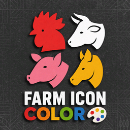

  

<h1 align="center">Farm Icon Color</h1>

  Custom farm logos and colours for <b>Farming Simulator 25</b> 
  Singleplayer · Multiplayer · Dedicated servers

  <a href="https://www.farming-simulator.com/mod.php?mod_id=366058"><b>Download on ModHub</b></a> ·
  <a href="converter/"><b>Logo converter</b></a> ·
  <a href="https://github.com/FantazzZdev/FS25_farmIconColor/issues"><b>Feedback &amp; bugs</b></a>

  <a href="#english">English</a> · <a href="#français">Français</a> · <a href="#deutsch">Deutsch</a>

---

## English

Farm Icon Color gives every farm a real visual identity. Choose a logo, apply the colour of your choice, and find your farm at a glance in the multiplayer menu, the farm list, on the map and on in-game markers.

### Features
- **34 built-in logos**, chosen from a grid (**Logos** button in the farm window).
- **Custom farm colour**, applied to the logo, the map and the markers.
- **Custom logos**: import your own logos (admin). They are saved in the savegame and sent automatically to every player, dedicated servers included, even to players who join later.
- **Coloured logos** keep their own colours; white logos take the farm colour.
- **Delete** a custom logo for every player (admin).

### Installation
Download the mod from [ModHub](https://www.farming-simulator.com/mod.php?mod_id=366058) (or from the in-game mod hub) and enable it in your savegame. On a dedicated server, install it like any other mod.

### Custom logos
1. Download the **logo converter**: open the [converter](converter/) folder, click `FarmIconColor-LogoConverter.html`, then **Download raw file**. It is a single file that runs offline in your browser (English, French, German); no image is sent over the Internet.
2. Drop your image (PNG, JPG, WEBP, SVG or DDS), give the logo a name and download the `.xml` file.
   Leave “Make the logo white” unchecked to keep the logo's colours.
3. Put the `.xml` in `Documents/My Games/FarmingSimulator2025/modSettings/FS25_farmIconColor/customLogos/`
4. In game, as admin: farm edit window → **Logos** → **Import** (INSERT).

### Controls
| Where | Action |
|---|---|
| Farm creation/edit window | **Logos** (L) or click the logo: opens the logo grid |
| Logo window | Confirm (Enter), Back (Esc) |
| Logo window, admin | Import (INSERT), Delete (DEL, press twice) |
| Singleplayer | F9: farm colour customisation |

### Feedback, suggestions and bugs
Open an [issue](https://github.com/FantazzZdev/FS25_farmIconColor/issues). For a bug, please give the mod version, the game mode (singleplayer, multiplayer, dedicated server) and attach your `log.txt`.

---

## Français

Icônes De Fermes Personnalisées donne une vraie identité visuelle à chaque ferme. Choisissez un logo, appliquez la couleur de votre choix et repérez votre ferme d'un coup d'œil dans le menu multijoueur, la liste des fermes, sur la carte et sur les repères en jeu.

### Fonctionnalités
- **34 logos intégrés**, choisis dans une grille (bouton **Logos** de la fenêtre de ferme).
- **Couleur de ferme personnalisée**, appliquée au logo, à la carte et aux repères.
- **Logos personnalisés** : importez vos propres logos (admin). Ils sont enregistrés dans la sauvegarde et envoyés automatiquement à tous les joueurs, serveurs dédiés compris, même à ceux qui se connectent plus tard.
- Les **logos en couleurs** gardent leurs couleurs ; les logos blancs prennent la couleur de la ferme.
- **Suppression** d'un logo personnalisé pour tous les joueurs (admin).

### Installation
Téléchargez le mod sur [ModHub](https://www.farming-simulator.com/mod.php?mod_id=366058) (ou depuis le ModHub du jeu) et activez-le dans votre sauvegarde. Sur un serveur dédié, installez-le comme n'importe quel autre mod.

### Logos personnalisés
1. Téléchargez le **convertisseur de logos** : ouvrez le dossier [converter](converter/), cliquez sur `FarmIconColor-LogoConverter.html`, puis sur **Download raw file**. C'est un seul fichier qui fonctionne hors ligne dans votre navigateur (français, anglais, allemand) ; aucune image n'est envoyée sur Internet.
2. Déposez votre image (PNG, JPG, WEBP, SVG ou DDS), donnez un nom au logo et téléchargez le fichier `.xml`.
   Laissez « Rendre le logo blanc » décoché pour garder les couleurs du logo.
3. Placez le `.xml` dans `Documents/My Games/FarmingSimulator2025/modSettings/FS25_farmIconColor/customLogos/`
4. En jeu, en tant qu'admin : fenêtre de modification de ferme → **Logos** → **Importer** (INSER).

### Commandes
| Où | Action |
|---|---|
| Fenêtre de création/modification de ferme | **Logos** (L) ou clic sur le logo : ouvre la grille des logos |
| Fenêtre des logos | Confirmer (Entrée), Retour (Échap) |
| Fenêtre des logos, admin | Importer (INSER), Supprimer (SUPPR, deux appuis) |
| Solo | F9 : personnalisation de la couleur de ferme |

### Remarques, suggestions et bugs
Ouvrez une [issue](https://github.com/FantazzZdev/FS25_farmIconColor/issues). Pour un bug, indiquez la version du mod, le mode de jeu (solo, multijoueur, serveur dédié) et joignez votre `log.txt`.

---

## Deutsch

Bauernhof-Symbolfarbe gibt jedem Hof eine echte visuelle Identität. Wähle ein Logo, wende die Farbe deiner Wahl an und erkenne deinen Hof auf einen Blick im Mehrspielermenü, in der Hofliste, auf der Karte und an den Markierungen im Spiel.

### Funktionen
- **34 integrierte Logos**, auswählbar in einem Raster (Schaltfläche **Logos** im Hof-Fenster).
- **Eigene Hoffarbe** für Logo, Karte und Markierungen.
- **Eigene Logos**: importiere deine eigenen Logos (Admin). Sie werden im Spielstand gespeichert und automatisch an alle Spieler gesendet, auch auf dedizierten Servern und an später verbundene Spieler.
- **Farbige Logos** behalten ihre Farben; weiße Logos übernehmen die Hoffarbe.
- **Löschen** eines eigenen Logos für alle Spieler (Admin).

### Installation
Lade den Mod im [ModHub](https://www.farming-simulator.com/mod.php?mod_id=366058) herunter (oder im ModHub im Spiel) und aktiviere ihn in deinem Spielstand. Auf einem dedizierten Server wird er wie jeder andere Mod installiert.

### Eigene Logos
1. Lade den **Logo-Konverter** herunter: öffne den Ordner [converter](converter/), klicke auf `FarmIconColor-LogoConverter.html` und dann auf **Download raw file**. Es ist eine einzige Datei, die offline in deinem Browser läuft (Deutsch, Englisch, Französisch); kein Bild wird ins Internet gesendet.
2. Lege dein Bild ab (PNG, JPG, WEBP, SVG oder DDS), gib dem Logo einen Namen und lade die `.xml`-Datei herunter.
   Lass „Logo weiß machen“ nicht angehakt, damit das Logo seine Farben behält.
3. Lege die `.xml` in `Documents/My Games/FarmingSimulator2025/modSettings/FS25_farmIconColor/customLogos/`
4. Im Spiel als Admin: Hof-Bearbeitungsfenster → **Logos** → **Import** (EINFG).

### Steuerung
| Wo | Aktion |
|---|---|
| Fenster zum Erstellen/Bearbeiten des Hofs | **Logos** (L) oder Klick auf das Logo: öffnet das Logo-Raster |
| Logo-Fenster | Bestätigen (Enter), Zurück (Esc) |
| Logo-Fenster, Admin | Import (EINFG), Löschen (ENTF, zweimal drücken) |
| Einzelspieler | F9: Anpassung der Hoffarbe |

### Feedback, Vorschläge und Fehler
Erstelle ein [Issue](https://github.com/FantazzZdev/FS25_farmIconColor/issues). Bei einem Fehler bitte die Mod-Version, den Spielmodus (Einzelspieler, Mehrspieler, dedizierter Server) angeben und die `log.txt` anhängen.

---

  © Equinox · <a href="CHANGELOG.md">Changelog</a> · <a href="docs/DEVELOPMENT.md">Development</a>

